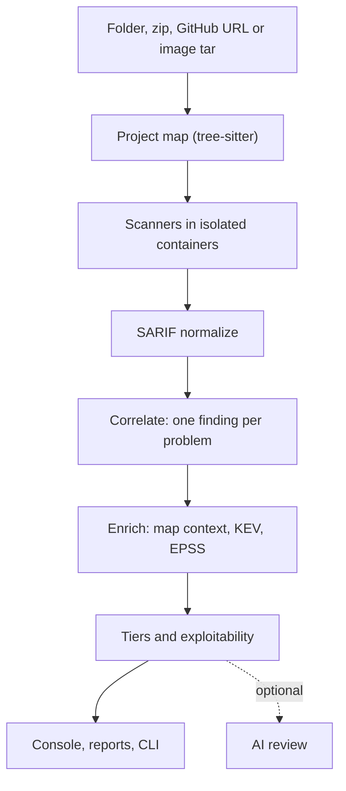

<p align="center">
  <picture>
    <source media="(prefers-color-scheme: dark)" srcset="web/public/brand/grephunt-logo-dark.svg">
    
  </picture>
</p>

<p align="center">
  <b>One console for 25 security scanners: one finding per real problem, ranked by how exploitable it is, with the noise moved out of the way.</b>
</p>

<p align="center">
  
  
  
  
  
  
</p>

<p align="center">
  <a href="#features">Features</a> ·
  <a href="#how-it-works">How it works</a> ·
  <a href="#scanners">Scanners</a> ·
  <a href="#benchmarks">Benchmarks</a> ·
  <a href="#quick-start">Quick start</a> ·
  <a href="#cli">CLI</a> ·
  <a href="#configuration">Configuration</a>
</p>

---

Running Semgrep, CodeQL, Trivy, Checkov and a secret scanner on the same repository gives you five reports, three formats and the same SQL injection five times. Grephunt runs the scanners for you in isolated containers, reads everything as SARIF, folds duplicates into one finding with every tool listed as a confirmation, and ranks what is left by how likely it is to be exploitable. Findings that are not worth your first look (code the app never loads, informational notes, infrastructure checks, patterns a data-flow engine did not back) move to their own tabs instead of being deleted.

It reads your code and never runs it. Everything works offline except the optional AI review and registry rulesets.

## Features

| | |
|---|---|
| **25 scanners, one run** | Code, secrets, dependencies and infrastructure as code. Pick the tools per scan; each runs in its own container with the project mounted read-only. |
| **One finding per problem** | Reports from different tools are merged by vulnerability class and place. Repeats in one file fold into one finding with every line listed. Advisories for one package fold into one row. |
| **Noise tiers, nothing deleted** | Main, Needs review, Not executed, Hygiene, Infra & CI. On Juice Shop the main list drops from 274 to 132 findings without losing a known vulnerability. |
| **Exploitability score** | Severity, reachability from a route, queries built from variables, tool agreement, CISA KEV and FIRST EPSS for CVEs. Every score shows the reasons behind it. |
| **Project map** | Files, imports and architecture (frontend → route → handler → database) parsed with tree-sitter before any scanner runs. Findings are drawn on the map; export to Mermaid or Obsidian. |
| **AI review (optional)** | Gemini or DeepSeek with your own key: explain a finding, triage a whole scan against the full enclosing function, or write a validation walkthrough for your own app. Verdicts re-rank findings and never delete them. |
| **Scan rules** | Exclude folders per scan: ready-made lists (installed packages, build output, caches), your own names or globs, `!name` to keep a folder, `re:` for regular expressions. |
| **Benchmarks built in** | `grephunt bench` scores a scan against OWASP Benchmark or a list of known bugs and reports recall, false-positive rate, the effect of a second engine, of AI triage and of the exploitability threshold. |
| **Reports** | PDF, Markdown and plain text from the console; merged SARIF and JSON from the CLI. |
| **Container images** | Scan a `docker save` or OCI tar with the scanners that understand images. |

## How it works



1. **Map.** The project is parsed before scanning: file roles, imports, routes, HTTP calls and database access. The map later tells which route reaches a finding and which files the app never loads.
2. **Scan.** Each selected tool runs in Docker with `cap_drop: ALL`, no new privileges, a read-only mount of the project, and network only when the tool needs it (registry rules, database updates, optional key verification).
3. **Normalize.** Every result becomes one finding record with a fingerprint and a correlation key. Secret values are redacted before anything is stored.
4. **Correlate.** Reports are merged by CWE class, file and the place the dangerous data is used. Each merged finding keeps every original report as a confirmation.
5. **Rank.** Tiers and the exploitability score are computed on read, so they improve on old scans too.

## Scanners

| Group | Tools |
|---|---|
| **Code** | Semgrep, CodeQL, Bearer, Snyk Code, DevSkim, Bandit, Gosec, Psalm, Progpilot, Brakeman |
| **Secrets** | Gitleaks, Betterleaks, TruffleHog, Kingfisher, Secretlint |
| **Dependencies** | Trivy, Grype, OSV-Scanner, Snyk Open Source, Syft (SBOM) |
| **Infrastructure** | Checkov, KICS, Hadolint, Kubescape, Zizmor |

Grephunt also ships its own Semgrep taint rules for Java, JavaScript/TypeScript, PHP, Go and Python. A new scanner is a YAML descriptor in `grephunt/scanner_catalog/`; a Python hook is needed only when the tool has to prepare state or prints a non-standard format.

## Benchmarks

Measured with `grephunt bench` against projects whose vulnerabilities are known.

| Project | What is measured | Result |
|---|---|---|
| **OWASP Juice Shop 20.3** | Main list after noise tiers | 274 → **132** findings (−52%), **0** of the marked vulnerabilities moved off the main list |
| **OWASP Juice Shop 20.3** | Recall on coding challenges marked in the source | **14 / 33** (Injection 7/8, XSS 3/3) |
| **DVWA 2.5** | Recall per module (statically detectable modules) | **8 / 13** |
| **DVWA 2.5** | Main list after noise tiers | 279 → **201** (−28%); the 14 findings moved to *Needs review* were all false positives on escaped or hashed input |
| **OWASP Benchmark 1.2** | Semgrep with Grephunt Java rules, before second engines | recall **60%**, false-positive rate 39% |

The misses are mostly what static analysis cannot see: business logic, password reset flows, missing CSRF tokens, DOM XSS inside templates. Closing them is the job of the dynamic stage on the roadmap.

## Quick start

**Requirements:** Python 3.11+, Node.js 20+, Docker Desktop (or a Docker daemon).

```bash
git clone https://github.com/ivanstavytskyi/grephunt.git
cd grephunt
pip install -r requirements.txt
cd web && npm install && npm run build && cd ..
python -m grephunt serve
```

Open **http://127.0.0.1:4000**, choose a folder, a zip, a GitHub link or an image tar, tick the scanners and start. The first run of each scanner pulls its image.

For UI development run the API and Vite side by side; the dev server on port 5173 proxies `/api` to port 4000:

```bash
python -m grephunt serve
cd web && npm run dev
```

## CLI

| Command | What it does |
|---|---|
| `grephunt scan <path> -s semgrep -s trivy` | Scan a folder; reports go to `reports/<project>/` (`findings.json`, `scan.json`, `merged.sarif`) |
| `grephunt scan --image app.tar` | Scan a container image saved with `docker save` |
| `grephunt serve` | Web console on port 4000 |
| `grephunt map <path>` | Build the project map without scanning |
| `grephunt bench <findings> <expected>` | Score a scan against OWASP Benchmark CSV or an `expected.yaml` |
| `grephunt doctor` | Check Docker and remove stale scanner containers |
| `grephunt models download` | Fetch the small offline embedding model used to cluster findings by meaning |

## Configuration

| Variable | Default | Purpose |
|---|---|---|
| `GREPHUNT_PORT` | `4000` | Console port |
| `GREPHUNT_DATA` | `./data` | Scans, caches, the SQLite database |
| `GREPHUNT_DATABASE_URL` | SQLite in `GREPHUNT_DATA` | Any SQLAlchemy URL |
| `GREPHUNT_MAX_UPLOAD_MB` / `GREPHUNT_MAX_IMAGE_MB` | | Upload limits for archives and image tars |
| `GREPHUNT_AI_SCAN_FINDINGS_MAX` | | How many findings the AI scan report reads |

AI keys are entered in the console and stay in your browser; they are sent only with your own AI requests.

## Repository layout

```
grephunt/
  scanner_catalog/   one YAML descriptor per scanner, Grephunt's own Semgrep rules
  scanner_hooks/     tool-specific behaviour (rulesets, databases, key verification)
  execution/         Docker or local binaries, caches
  scan_pipeline/     SARIF parsing, converters, excludes, the scan view
  finding_model/     the finding record, correlation, tiers, exploitability
  project_map/       tree-sitter parsers, imports, architecture, unreferenced files
  intel/             CISA KEV and FIRST EPSS feeds
  bench/             OWASP Benchmark and known-bug scoring
  web_console/       FastAPI app, scans, AI review
web/                 React console (Vite, Tailwind, React Flow)
samples/             small projects with planted bugs and clean twins
tests/               unit tests and SARIF fixtures that need no Docker
```

```bash
pip install pytest httpx
pytest -m "not integration"   # no Docker needed
pytest -m integration         # pulls scanner images, needs Docker
```

## Roadmap

- External reconnaissance of a live target: subdomains, URLs from archives, stack, exposed panels.
- A sandbox where an agent confirms a finding against your own running app and records a proof-of-concept, with a hard scope limit that is set by a person, not by the model.
- Baseline mode for CI: show only what is new compared with the previous scan.

## Contributing

Issues and pull requests are welcome. Keep changes small, add a test next to the code you touch, and run `pytest -m "not integration"` before opening a pull request. A new scanner needs a descriptor, a sample project it finds something in, and a fixture test.
